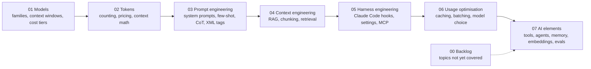

# AI Engineering Reference

A personal library of concise reference cards on building with LLMs: models, tokens, prompting, context, the Claude Code harness, cost optimisation and the building blocks of AI applications. Each card is short, scannable and cross-linked.

> **Verify before relying on it.** Model names, context windows and prices change quickly. Check specs and costs against the providers' official documentation before using any figure here.

## Map of the library

## Which card do I need?

| Question | Card |
|---|---|
| Which model should I use? | [01-models-reference.md](01-models-reference.md) |
| Why is my bill high? What are tokens? | [02-tokens.md](02-tokens.md) |
| How do I write better prompts? | [03-prompt-engineering.md](03-prompt-engineering.md) |
| How do I manage large context or add RAG? | [04-context-engineering.md](04-context-engineering.md) |
| How does the Claude Code harness work? | [05-harness-engineering.md](05-harness-engineering.md) |
| How do I cut cost and latency? | [06-usage-optimization.md](06-usage-optimization.md) |
| What are tools, agents, embeddings, evals? | [07-ai-elements.md](07-ai-elements.md) |
| What is planned next? | [00-backlog.md](00-backlog.md) |

## How to use it

1. Jump to the right card from the table above.
2. Read the summary at the top of the card first, then the section you need.
3. Follow the cross-links where topics overlap.

## Status

Working notes, not a published guide. The backlog lists topics still to write: reasoning models, fine-tuning, safety and guardrails, multimodal, observability, orchestration frameworks and more.

## License

[MIT](LICENSE)
